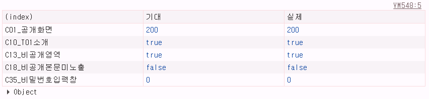
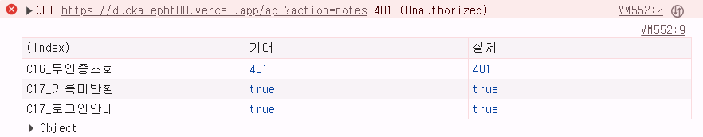
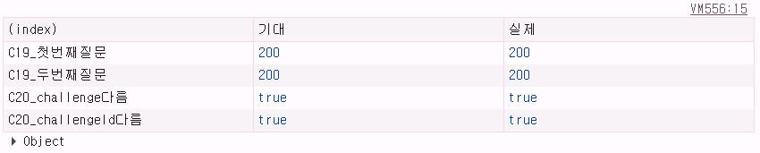
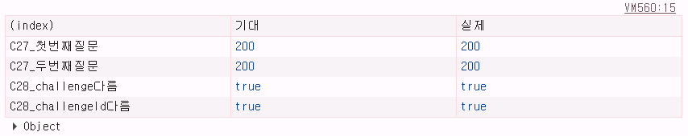
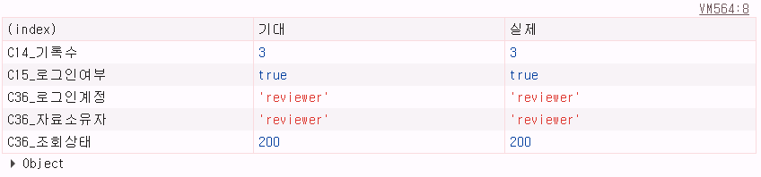
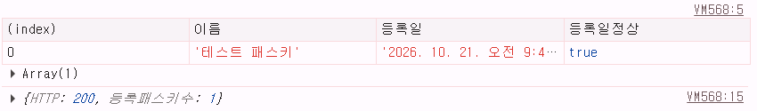
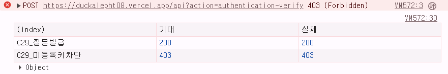

# T08 제출 직전 콘솔 실측 — 7개 검사 묶음

검사 날짜: **2026-10-21**  
검사 사이트: https://duckalepht08.vercel.app/  
실행 환경: PC Chrome 개발자 도구 Console, 정상 로그인 계정 **reviewer** (무인증 요청만 쿠키 전송 생략)

> 이 문서는 사용자가 실제로 실행해 전송한 7장의 화면에 표시된 값을 정리한 것입니다. 검증 응답에 포함되는 challenge 문자열이나 쿠키·서명은 문서에 공개하지 않습니다. 아래에 각 검사에서 확보한 원본 캡처 7장을 실제 출력 순서대로 함께 첨부했습니다. 수치는 스크린샷에 표시된 그대로 옮겼습니다.

| 순서 | 항목 | 기대 | 콘솔 실제 | 결과 |
| --- | --- | --- | --- | --- |
| 1 | C01 공개 페이지 | 200 | **200** | PASS |
| 1 | C10 T01 소개 표식 | true | **true** | PASS(보조 표식 검사) |
| 1 | C13 T08 비공개 섹션 | true | **true** | PASS |
| 1 | C18 공개 HTML 내 가상 기록 본문 노출 여부 | false | **false** | PASS |
| 1 | C35 비밀번호 입력 필드 수 | 0 | **0** | PASS |
| 2 | C16 쿠키 없이 비공개 기록 조회 | 401 | **401** | PASS |
| 2 | C17 records 미반환 / 로그인 안내 | true / true | **true / true** | PASS |
| 3 | C19 등록 질문 연속 발급 | 200 / 200 | **200 / 200** | PASS |
| 3 | C20 challenge / challengeId 각각 다름 | true / true | **true / true** | PASS |
| 4 | C27 로그인 질문 연속 발급 | 200 / 200 | **200 / 200** | PASS |
| 4 | C28 challenge / challengeId 각각 다름 | true / true | **true / true** | PASS |
| 5 | C14 본인 기록 수 | 3 | **3** | PASS |
| 5 | C15 로그인 상태 | true | **true** | PASS |
| 5 | C36 세션 계정·자료 owner·HTTP | reviewer / reviewer / 200 | **reviewer / reviewer / 200** | PASS |
| 6 | C24·C43 패스키 목록과 등록일 유효성 | 키 1개, true | **테스트 패스키 1개, true** | PASS |
| 6 | C43 passkeys API 응답 | 200 | **200** | PASS |
| 7 | C29 미등록 credential ID 거절 | 질문 200 / 인증 403 | **200 / 403** | PASS |

## 결과 읽는 방법

- 401 Unauthorized·403 Forbidden이 콘솔에서 빨간색으로 나타나는 것은 의도된 실패 요청이 거절된 결과입니다.
- C18의 `false`는 공개 페이지에 가상 비공개 기록 문자열이 없다는 뜻입니다. C35의 `0`은 입력 화면에 비밀번호 필드가 없다는 뜻입니다.
- C20/C28은 질문 원문 자체를 문서에 복사하지 않고 다른지 여부를 boolean으로 비교했습니다. 앞선 DB 집계(등록 17/17, 로그인 48/48 고유)와 서로 일치하는 실측입니다.
- C43 등록일은 서버의 `createdAt` 값을 사용자 기기의 한국 표준시 표시로 변환해 유효 여부 true까지 확인했습니다.
- 화면 검색 문자열만으로 T01 전체 파일의 원본 동등성을 증명할 수 없으므로, C10은 기존 T01 원본 확인 테스트와 함께 판정해야 합니다.
- 검사별 원본 PNG 7장은 이 문서와 같은 `evidence` 폴더에 있습니다. 아래의 화면에서 실제 출력값을 직접 확인할 수 있습니다.

## 원본 콘솔 캡처 7장

### 1. C01·C10·C13·C18·C35 공개 영역 검사

### 2. C16·C17 로그인 없는 접근 거절

### 3. C19·C20 등록 질문 비교

### 4. C27·C28 로그인 질문 비교

### 5. C14·C15·C36 계정과 자료 확인

### 6. C24·C43 패스키 이름·등록일

### 7. C29 미등록 자격 증명 거절

