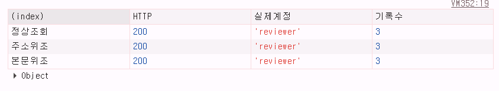

# T08 보안 검사 결과

**검사일: 2026-10-21** · 운영 결과물 https://duckalepht08.vercel.app/ · 최신 소스 https://github.com/BoatingDuck/aleph-assignments/tree/main/T08

**기록 기준:** 실제로 응답을 관찰한 실측, 데이터베이스 집계, 코드·자동 검사, 추가 캡처가 없는 부분을 구분합니다. 성공하지 않은 항목을 임의로 통과라고 적지 않았습니다.

## 1. 실제 운영 환경과 사용 장치

- 실제 로그인: **아이폰 암호(Passwords) 앱의 WebAuthn 패스키**로 QR 스캔·승인을 진행하고 PC 자동 로그인 확인. 아이폰 단독 로그인도 확인했습니다.
- 보안 실험: PC **Chrome DevTools → WebAuthn 가상 인증기**, protocol CTAP2, transport internal, resident keys·user verification·automatic presence simulation 지원. 별도 생성한 검사용 패스키로 실제 T08 운영 API에 요청했습니다.
- 자동 검사: GitHub Actions의 Node.js 22 환경에서 **31/31 통과**. 이 숫자만으로 운영 HTTP 실측을 대체하지 않습니다.
- 데이터: Supabase PostgreSQL. 실습 계정은 owner·reviewer이며 실제 개인정보가 아닌 가상 자료를 사용합니다.

아이폰은 정상 로그인에 사용했지만, WebAuthn 서명 원본을 바꾸고 동일 JSON을 재전송하는 공격 실험을 모바일 브라우저로 재현하기 어려웠습니다. 아이폰 단축어 방법도 시도했다가 결과 전달 문제 때문에 사용하지 않았습니다. **정상 기기 사용성과 보안 공격 재현을 분리**하기 위해 PC 가상 인증기를 선택했습니다. 가상 인증기 테스트를 아이폰에서 직접 한 것처럼 서술하지 않습니다.

## 2. 실측 결과

| 항목 | 직접 수행한 방법 | 확인한 응답·결과 | 판정 |
| --- | --- | --- | --- |
| C23 등록 요청 | 가상 키 추가 등록 후 Chrome Network의 `registration-verify` Payload 확인 | 표시된 부분에 `challengeId`, `label`, `response`, `id` 등 확인, 개인키 필드 없음. DB에는 공개키 저장. **하위 Payload 일부는 접힌 상태** | 등록·공개키 실측, 하위 필드 캡처 보완 가능 |
| C25 등록 취소 | 추가 등록 중 기기 인증을 취소, DB 등록 개수 다시 조회 | 취소 안내 표시, 기존 등록 수 불변 | **PASS** |
| C30 서명 변조 | 가상 인증기의 원본 서명 한 비트 변경한 뒤, 같은 질문의 원본 정상 서명 전송 | **403 → 200** | **PASS (가상 인증기 운영 HTTP)** |
| C31 질문 재사용 | C30 정상 인증에 사용한 완전 동일 `{challengeId,response}` 다시 전송 | **409 Conflict** | **PASS (가상 인증기 운영 HTTP)** |
| C33 로그아웃 | 기존 로그인 쿠키로 records API 200 → 사이트에서 로그아웃 → 동일 쿠키로 다시 요청 | **200 → 401 Unauthorized**. 기존 세션으로 데이터 반환하지 않음 | **PASS** |
| C39 계정 격리 | owner→reviewer, reviewer→owner 반대 계정 직접 요청 및 전후 본인 자료 조회 | 양방향 **403**, 각 본인 요청 **200·3건 → 200·3건** | **PASS** |
| C40 계정 위조 입력 차단 | reviewer 로그인 후 정상 GET·`?account=owner` GET·`{"account":"owner"}` POST 실행 | 세 요청 모두 **200 / 실제 소유자 reviewer / 3건** | **PASS** |
| C44 키 삭제 후 로그인 | reviewer의 중복 추가 키 `테스트2 패스키` 삭제 후 남은 아이폰 키로 다시 로그인 | 등록 수 **2→1**, 본인 기록 **3건 표시** | **PASS** |
| C45 삭제 키 인증 거절 | 새로운 가상 패스키에서 서명 확보 → 그 키를 삭제 → 삭제된 credential ID·서명으로 검증 요청 | 삭제 **200**, 인증 **403**, 남은 키 **1개** | **PASS (가상 인증기 운영 HTTP)** |
| C46 마지막 키 방지 | reviewer에 1개 남은 상태에서 마지막 키 삭제 API 요청 | **409 Conflict**, 1개 그대로 유지 | **PASS** |

**C33 참고:** 첫 요청은 사용자가 로그아웃을 누르기 전에 실행하여 200이 나왔습니다. 이후 실제로 사이트에서 로그아웃하고 동일 요청을 다시 전송했을 때 **HTTP/1.1 401 Unauthorized**와 `패스키 로그인 후 확인할 수 있습니다.`가 반환됐습니다. 이는 보안 문제가 아니라 시험 순서를 바로잡아 확인한 결과입니다.

**C30/C31 참고:** 변조를 먼저 보냈기 때문에 해당 요청은 정상 로그인 질문을 소비하지 않았습니다. 이어서 원본 정상 서명을 보낼 수 있었고, 그 성공 요청을 그대로 재전송하면 409로 거절됐습니다.

**C45 참고:** 시험용 키의 서명을 **삭제하기 전에 확보**했습니다. 삭제 후에는 이미 없는 credential ID로 인증해야 하므로 403으로 거절됐습니다. 최종 패스키 목록의 남은 1개는 reviewer의 정상 사용 키입니다.

## 3. 질문·키·자료의 DB 집계

2026-10-21 최종 읽기 전용 조회 결과:

| 확인 대상 | 관찰한 결과 |
| --- | --- |
| 등록 질문(challenge) | **17개 / 고유한 값 17개**, 그중 사용 완료 5개 |
| 로그인 질문(challenge) | **48개 / 고유한 값 48개**, 그중 사용 완료 20개 |
| 공개키 | owner/reviewer 각각 정상 패스키에 공개키 값 존재 (base64url 길이 각 103자) |
| 등록된 최종 패스키 | **owner 1개, reviewer 1개** |
| 가상 비공개 기록 | **owner 3건, reviewer 3건** |
| QR 인증 연결 | 사용자 PC QR 승인이 로그인으로 소비된 기록 **2건** 확인 |

질문 17/17과 48/48은 **DB에서 중복 없음**을 확인한 결과이며, 각 질문 원문을 2개씩 나란히 게시했다는 뜻은 아닙니다. 시험 중 신규 등록·삭제·로그인이 진행됐기 때문에 다른 시점의 총계와 구분해야 합니다.

## 4. 계정 보안과 비공개 경계

운영 페이지의 **GET /** 는 로그인 없이 HTTP 200이었고, HTML 응답에 가상 비공개 메모 본문이 포함되지 않았습니다. `GET /api?action=status`는 로그인하지 않은 상태에서 HTTP 200과 `signedIn:false`를 반환합니다. 실제 로그인 후 해당 계정의 `GET /api?action=notes`는 200·3건입니다.

서버는 세션을 확인한 뒤 자료를 조회합니다. `account-notes` 요청에서 계정이 다르면 403으로 차단하며, 상대 계정에 대한 조회 전후의 자료 수는 동일했습니다. URL 쿼리와 POST body의 임의 account 값을 무시하도록 하는 코드도 확인했지만 **그 두 방식의 개별 HTTP 캡처는 보존하지 않았습니다**.

Supabase에는 `t08_accounts`, `t08_notes`, `t08_passkeys`, `t08_invites`, `t08_challenges`, `t08_sessions`, `t08_phone_logins` **7개** 테이블이 있고, RLS 및 브라우저 anon/authenticated 역할 접근 제한을 설정했습니다. DB 접속 문자열은 서버 전용으로 보관했습니다.

## 5. 증거의 한계와 보안 사항

- **증빙 보완 가능:** C03 시크릿 창 별도 사진, C20 등록 질문 2개 원문 나란히 표시, C22 공개키 전체 출력, C23 Network `response` 아래 접힌 필드, C40 검사 캡처는 아래에 첨부했습니다. C46의 **패스키 0개 상태**는 정상 키를 잃을 수 있어 만들지 않았으며, 마지막 키 삭제 거절 409는 실측했습니다.
- C23 공개된 캡처에서 보이지 않는 속성까지 관찰했다고 쓰지 않았습니다. 서버 소스와 공개키 저장 DB 구조를 함께 확인했습니다.
- 민감한 **세션 쿠키, 원본 서명, QR 일회용 토큰, 초대 URL, 데이터베이스 비밀번호**는 이 문서에 넣지 않았습니다. 브라우저 캡처도 요청 필드 값을 가리거나 접은 상태로 공유했습니다.
- 이 결과들은 과제용 실험입니다. 독립 복구 절차, 운영용 속도 제한·감사 로깅까지 완료했다고 주장하지 않습니다.

자세한 설계와 실험 의도는 [인증구현설명서](인증구현설명서.md), 기기 분리 과정은 [아이폰/PC 실험 기록](PC_휴대폰_QR로그인_최종검사.md), 전체 조건은 [조건별재점검](조건별재점검.md)에 정리했습니다.

### C40 실제 검사 화면

2026-10-21, reviewer 로그인 상태에서 URL·본문 계정 위조 요청을 각각 실행했습니다. 표의 세 줄 모두 `HTTP 200`, `실제계정 reviewer`, `기록수 3`이므로 클라이언트가 제시한 owner 계정명이 비공개 자료 선택에 반영되지 않았습니다.

